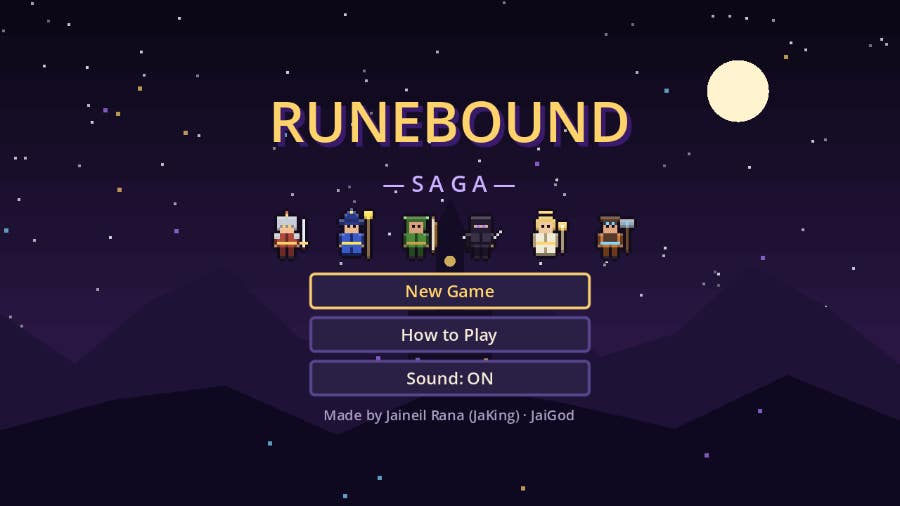
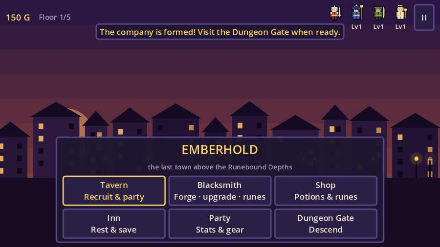
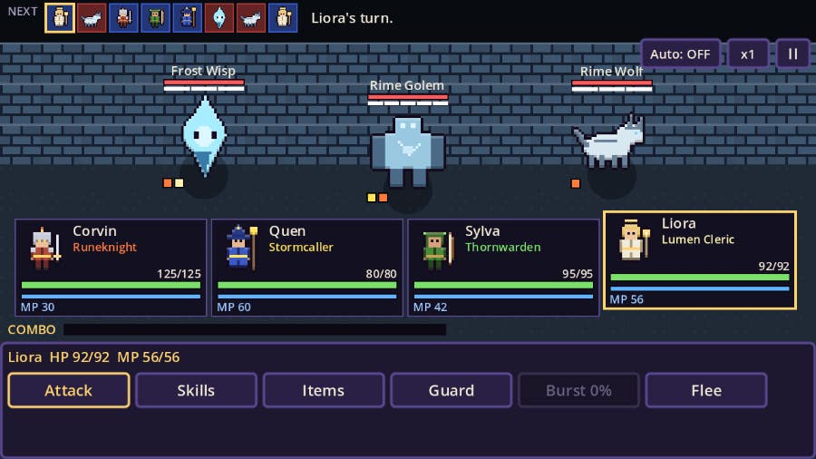
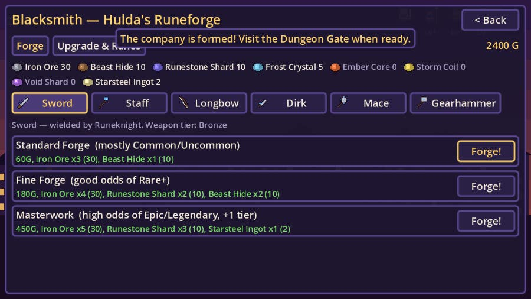
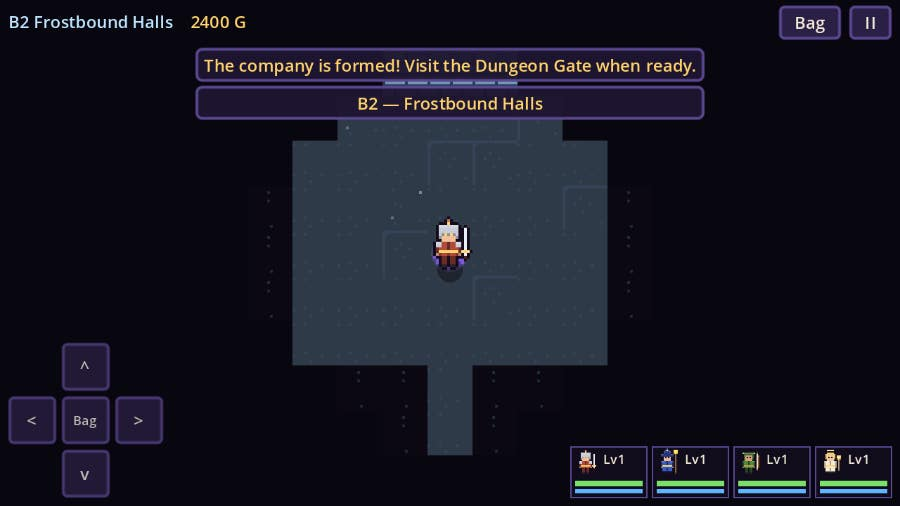
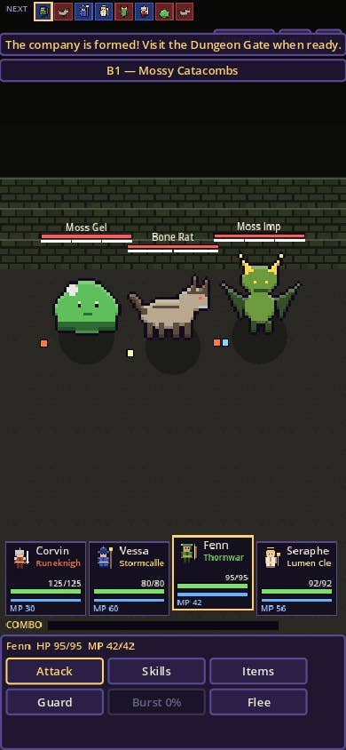

<div align="center">

# ⚔️ Runebound Saga

**An original pixel-art turn-based party RPG with a blacksmith forge, made in Godot 4.**

Recruit a company of four heroes, forge rune-weapons and fight down five dungeon floors to defeat the Umbral Regent.

[](https://jaigod.github.io/runebound-saga/play/)

[](https://jaigod.github.io/runebound-saga/)
[](https://godotengine.org)
[](scripts/)
[](https://github.com/JaiGod/runebound-saga/actions)
[](LICENSE)

</div>

---

## 📸 Screenshots

| Title screen | Emberhold town |
|:---:|:---:|
|  |  |
| **Turn-based battle with the initiative timeline** | **Hulda's Runeforge (blacksmith)** |
|  |  |
| **Dungeon exploration with fog of war** | **Phone (portrait)** |
|  |  |

## ✨ Features

- 🧙 **6 hero classes**: Runeknight, Stormcaller, Thornwarden, Shadeblade, Lumen Cleric and Gearsmith. Each has 4 skills, its own element and a weapon type. **Recruit 4** to found your company, and hire the rest later at the Tavern.
- ⏳ **Initiative timeline**: speed decides who acts next. The top bar previews the next 8 turns, and Haste, Slow and Freeze reshuffle it.
- 💥 **Weaknesses & Break**: 7 elements (Physical, Fire, Ice, Storm, Nature, Light, Shadow). Hitting a weakness cracks the enemy's guard, chains build the Combo meter, and a full meter unleashes a party-wide **Rune Burst**.
- 🔨 **Blacksmith forge**: forge from materials (Standard, Fine or Masterwork recipes), upgrade weapons **+1 to +5**, socket **10 kinds of elemental runes**, and salvage spares for materials.
- 💎 **Loot with affixes**: 5 rarities from Common to Legendary, 5 weapon tiers (Bronze to Voidtempered), and rolled affixes such as lifesteal, crit, speed and break power.
- 🏰 **5 dungeon floors with bosses**: procedural grid dungeons with fog of war, chests, hidden traps, fountains and roaming monsters.

  | Floor | Area | Boss |
  |:---:|---|---|
  | B1 | Mossy Catacombs | Rotroot Colossus |
  | B2 | Frostbound Halls | Glacial Warden |
  | B3 | Ember Forge-Depths | Forgeheart Drake |
  | B4 | Storm Spire Vault | The Thunder Engine |
  | B5 | Umbral Sanctum | The Umbral Regent |
- 💾 **Saves**: automatic save in town and at the Inn, plus a Continue button on the title screen (Godot `user://`, which maps to IndexedDB on the web).
- 🎨 **All art and audio are made in code**: pixel sprites are drawn from code (`Pix.gd`), sound effects are synthesized (`Sfx.gd`), and the game has screen shake, particles, damage numbers, a pause menu, a sound toggle, and win/lose screens.
- 📱 **Works on desktop and phone**: keyboard, mouse or touch, with a layout that adapts to landscape and portrait.

## 🎮 Controls

| Action | Keyboard / mouse | Touch |
|---|---|---|
| Move in the dungeon | Arrow keys / WASD, or click a tile | Tap a tile or use the on-screen pad |
| Menus | Click, or arrows + Enter/Space | Tap |
| Choose a target | Click an enemy or ally, or arrows + Enter | Tap |
| Pause / back | Esc or P | **II** button |
| Speed up battles | **x1/x2** button, **Auto** toggle | same |

## 🛠️ Tech stack

- **Engine:** [Godot 4.3](https://godotengine.org) with the Compatibility (WebGL 2) renderer
- **Language:** GDScript, with no external assets or plugins
- **Web export:** single-threaded (`variant/thread_support=false`), so it runs on GitHub Pages without COOP/COEP headers
- **CI/CD:** [GitHub Actions](.github/workflows/pages.yml) with the `barichello/godot-ci:4.3` image, which exports Web and deploys it to GitHub Pages

## 📁 Project structure

```
runebound-saga/
├── project.godot            # 640x360 pixel viewport, Compatibility renderer
├── export_presets.cfg       # Web preset (threads off)
├── scenes/Main.tscn         # root scene
├── scripts/
│   ├── Main.gd              # scene router, pause, toasts, screen shake
│   ├── Data.gd              # classes, skills, enemies, floors, runes, recipes
│   ├── Game.gd              # party, inventory, weapons, save/load
│   ├── Title.gd · Town.gd · Ending.gd
│   ├── Dungeon.gd           # procedural floors, fog, traps, chests
│   ├── Battle.gd            # timeline combat, weakness/break, combos
│   ├── Smith.gd · Shop.gd · PartyMenu.gd
│   ├── Pix.gd               # pixel art drawn in code
│   ├── Sfx.gd               # synthesized sound effects
│   └── ui.gd                # theme + widget helpers
├── tests/                   # headless smoke test + screenshot scripts
├── web/index.html           # landing page (copied to the Pages root)
├── docs/screenshots/        # README images
└── .github/workflows/pages.yml
```

Source folders: [`scripts/`](scripts/) · [`scenes/`](scenes/) · [`tests/`](tests/) · [`web/`](web/) · [`.github/workflows/`](.github/workflows/)

## 🚀 Run locally

1. Install [Godot 4.3](https://godotengine.org/download) (standard build).
2. Clone the repo: `git clone https://github.com/JaiGod/runebound-saga.git`
3. Open `project.godot` in Godot and press **F5**.

Headless smoke test, which auto-plays all 5 floors:

```bash
godot --headless --import
FLOORS=5 godot --headless res://tests/SmokeTest.tscn
```

Web build:

```bash
mkdir -p build/web/play
godot --headless --export-release "Web" build/web/play/index.html
cp web/index.html icon.svg build/web/ && cd build/web && python3 -m http.server 8000
```

## 📓 Development log

- **Design goal:** a compact JRPG loop of town, then dungeon, then boss, then back to town to forge. The Blacksmith is the main reason to go back to town. Materials drop by floor, so every floor unlocks better forging.
- **Timeline over rounds:** a speed-based initiative queue (shown as portraits at the top) makes Slow, Haste and Freeze feel tactical and makes the speed stat matter.
- **Weakness → Break → Burst:** hitting a weakness lowers an enemy's guard pips, which rewards bringing the right elements. Runes let any weapon add an element.
- **Everything in code:** heroes, monsters, tiles and UI icons are pixel arrays in `Pix.gd`, and sounds are generated waveforms in `Sfx.gd`. That keeps the repo tiny and 100% original.
- **Challenge, web threads:** the threaded web export needs COOP/COEP headers, which GitHub Pages can't send, so the game is exported single-threaded.
- **Challenge, balance:** an auto-battle smoke test plays all 5 floors headlessly and logs levels, gold, KOs and boss results. Floor 4 (Storm Spire) is the intended difficulty spike: the bot needed a few return trips to level up and forge Starforged gear before beating the Thunder Engine, and then it cleared the Umbral Regent.
- **Fix, phone portrait layout:** in portrait (360 px logical width) the Tavern recruit buttons and the Forge buttons were pushed off-screen by long one-line labels. Those labels now word-wrap, and every screen was re-checked at 390x844.
- **Screenshots** were captured from the real game with Godot under Xvfb (`tests/shots.gd`, `tests/portrait_shots.gd`).
- Beta tested on the live site ✅ (2026-11-05)

## 🌌 More from JaiGod

- 🏠 [JaiGod on GitHub](https://github.com/JaiGod): all of Jaineil's games and projects
- 🕯️ [The Hollow Between](https://github.com/JaiGod/the-hollow-between): story RPG made in Godot 4
- 🔗 [Browse all JaiGod repositories](https://github.com/orgs/JaiGod/repositories)

## 📜 License

[MIT](LICENSE) © 2026 Jaineil Rana

---

<div align="center">

Made by Jaineil Rana (JaKing) · part of [JaiGod](https://github.com/JaiGod)

</div>
